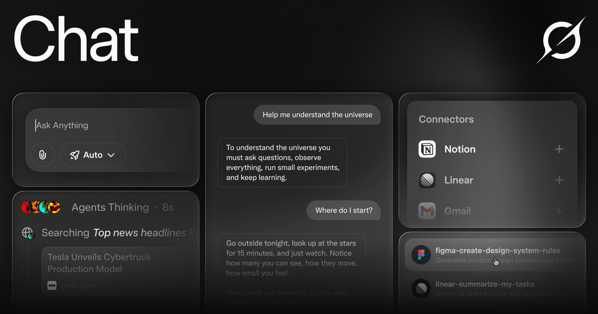
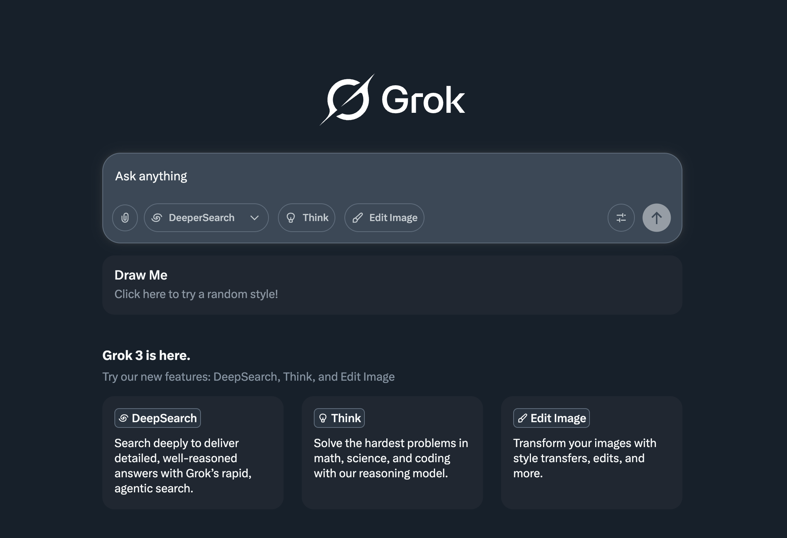

# Grok Chat

Grok Chat is the Grok assistant you talk to. It answers in the moment, with the web and with X in reach, and it can keep a voice conversation going while you stay on the same thread. grok bot is the agent side of that assistant: it can take a step for you, including mail from its own address. grok build is the coding seat, where the same account reads a repository and edits it. grok code is that coding pass, the one you open when the reply should be a patch instead of a paragraph.

You can use Grok on the web, inside X, on a phone, in a Tesla, and in Google Docs, Sheets, and Slides. A free seat covers ordinary chat, voice, and a limited amount of web and X search. A paid seat lifts the tight caps and opens heavier reasoning, sharper image and video tools, and the agent features.

This tree is the local companion. It holds public prompt text, a small JAX sample of the open Grok-1 weights, and settings from the coding agent. The pages below are about Grok Chat. The files are what you open when you want to see the shape of a prompt or a client call.


## Prompts

A Grok Chat session starts from a system prompt. The prompt tells the assistant who it is, which tools it may call, and how to treat a post, a PDF, or a piece of code. The copies in this tree are the public ones. They are templates, not a live account.

[grok4_system_turn_prompt_v8.j2](prompts/grok4_system_turn_prompt_v8.j2) is the system turn for the Grok 4 assistant on the web and on X. [ask_grok_system_prompt.j2](prompts/ask_grok_system_prompt.j2) is the prompt for the Grok bot on X, the voice behind @grok. [grok_4_code_rc1_safety_prompt.txt](prompts/grok_4_code_rc1_safety_prompt.txt) is the safety prefix injected for the fast code model on the API.

Other templates sit beside those three. `prompts/grok3_official0330_p1.j2` is the Grok 3 chat prompt. `prompts/grok_analyze_button.j2` is the explain action on X. `prompts/grok_4_safety_prompt.txt` and `prompts/grok_4_mini_system_prompt.txt` are prefixes for named API models. The 4.1 family is split into thinking and non-thinking files, with and without tools:

* `prompts/grok4p1_thinking_system_turn_prompt_v2.j2`
* `prompts/grok4p1_non_thinking_system_turn_prompt.j2`
* `prompts/grok4p1_non_thinking_no_tool_system_turn_prompt.j2`

Read a template before you paste it into a product. A safety prefix is not a full assistant. A bot prompt is not the web chat prompt. Mixing them produces a voice that does not match the surface you opened.

Jinja files (`.j2`) expect variables. A raw paste of `grok4_system_turn_prompt_v8.j2` into a chat box will show braces instead of a finished instruction. Render the template with the variables it names, then read the result. The `.txt` safety prefixes are plainer: they are inserted in front of the model call, and they are not a substitute for the system turn.

When you compare Grok 4 with Grok 4.1, compare the tool flag as well as the thinking flag. A non-thinking prompt with tools can still call search. A non-thinking prompt with no tools should stay inside the text you gave it. If a reply cites a post you did not paste, you are on the tool template.

The analyze prompt is narrower still. It explains a post on X. It should not book a meeting or edit a repository. That work belongs to grok bot and to grok build, under their own prompts.

## Model Specifications

The hosted assistant and the open weights sample are not the same artifact. Grok Chat is the product on grok.com and in the apps. The sample in this tree loads the Grok-1 open weights, a mixture-of-experts network published so people can check the format.

[model.py](model.py) defines `LanguageModelConfig` and `TransformerConfig`. [run.py](run.py) builds a config with a vocabulary of 128 times 1024, an end-of-sequence token of 2, and a sequence length of 8192, then asks the runner to sample. [checkpoint.py](model/checkpoint.py) is how those weights would be read. [runners.py](model/runners.py) exposes `InferenceRunner`, `ModelRunner`, and `sample_from_model`.

The published Grok-1 card, which this sample follows, is a 314 billion parameter mixture of 8 experts, with 2 experts used per token, 64 layers, 48 query heads, 8 key and value heads, and an embedding size of 6144. The tokenizer is SentencePiece with 131072 tokens. Rotary embeddings are on. The code can shard activations and use 8-bit weights. The maximum context in that sample is 8192 tokens. The MoE layer in the sample is written for correctness, not for speed. A machine without a very large GPU will not finish a real sample.

Do not treat 8192 as the limit of Grok Chat. The hosted models are a later line. Read the model name in the app before you plan a long PDF.

| Piece | What it is in this tree | What you use it for |
| --- | --- | --- |
| Grok Chat | The hosted assistant | Talk, search, voice, files |
| grok bot | The acting agent, including @grok | Mail, sign-up, scheduling |
| grok build | The terminal coding agent | Read a repo, edit, run |
| grok code | The coding model pass | A patch instead of a paragraph |
| Grok-1 sample | JAX loader in `run.py` | Check the open weight format |

| Seat | What stays open | What is capped |
| --- | --- | --- |
| Free | Chat, voice, some web and X search | Tight usage |
| Paid | Heavier reasoning, higher resolution image and video, agent tools | The caps loosen |

This page does not print a price. The app shows the plans. Confirm them there before you subscribe.

## Documentation

Grok Chat documents itself in the product: a composer, a model picker, and a tool list. Voice mode is a conversation, not a file you upload after the fact. Image and video generation take a text prompt and return media. PDF analysis takes a document and answers questions about that document. Web search and X search are live. They are not a frozen index from last month.

[welcome.yaml](welcome.yaml) is a UI scenario for the first screen of the coding seat. [image_inputs.yaml](scenarios/image_inputs.yaml) covers image chips in that seat. [mock_response.yaml](scenarios/mock_response.yaml) is a scripted reply, useful when you want the layout without a live model. [folder_trust_prompt.yaml](scenarios/folder_trust_prompt.yaml) is the trust prompt before an agent reads a directory.

The coding seat also has help, selection, and plan nudges in scenario files: `scenarios/shortcuts_help_detail.yaml`, `scenarios/copy_selection.yaml`, `scenarios/html_entities.yaml`, `scenarios/plan_nudge_shows.yaml`, and `scenarios/release_notes_scroll.yaml`. They are tests of the terminal UI, not pages of the website.

A scenario is a script for the terminal, with a starting size and a list of keystrokes. Use one when a layout bug is easier to replay than to describe. `scenarios/vim_modal_command_palette.yaml` is the modal palette. Open it when a shortcut works in the chat composer and fails in the coding seat. The two seats do not share a keymap.

Docs for the hosted chat stay in the product. Docs for the terminal seat describe slash commands, sessions, memory, and a sandbox. Memory is a file the agent can reread later. The sandbox is the rule for what that agent may write. Turn the sandbox on before you let grok code touch a repository you did not create.

Voice, image, and video do not have scenario files in this tree. Try those in Grok Chat itself. A YAML script cannot play audio.



## Repository layout

The companion tree is flat on purpose.

| Path | What is in it |
| --- | --- |
| `prompts/` | Public system prompts for chat, the X bot, and code safety |
| `model/` | Checkpoint reader and inference runners for the open weights |
| `relay/` | JSON fixtures for bot relay methods, events, and errors |
| `scenarios/` | YAML scripts for the terminal UI |
| Root | `run.py`, `model.py`, package and Rust toolchain files |

[package.json](package.json) names the terminal package `@xai-official/grok`. The bin is `grok`. The only script is `postinstall`, which calls `bin/postinstall.js`. That script file is not in this set. Node 20 or newer is what the manifest asks for. [config.toml](config.toml) is the Cargo config. [rust-toolchain.toml](rust-toolchain.toml) pins the Rust toolchain. `Cargo.toml` at the root is the generated workspace file. Treat it as read-only. `clippy.toml` and `rustfmt.toml` are the lint and format settings.

Bot relay fixtures describe the wire, not a server you should expose. [method_status_result.json](method_status_result.json) is a status result. [error_no_plan.json](relay/error_no_plan.json) is the error when a plan is missing. Neighbors in `relay/` cover command params, roster, subscribe, consent, email verification, usage, link required, and turn finished. Read them when a client must show a specific failure instead of a generic one.

## Downloading the weights

The open weights are not part of Grok Chat the website, and they are not in this folder. The sample only shows how a loader would read them. If you choose to fetch them, put the `ckpt-0` directory where `run.py` expects a checkpoint path, then run the script. The model card warns that the network is large. A laptop that can chat with Grok Chat cannot run this sample.

Prefer the hosted assistant for every normal task: a question, a PDF, a voice note, an image, a video, a search on the web or on X. Download weights only when the job is to study the published Grok-1 format. Do not point grok bot or a Tesla session at those files. The car, the phone, and the website already have the hosted model.

Keep the checkpoint off a shared drive. The Apache grant covers the weights you downloaded. It does not cover a customer's documents, and it does not make a private PDF into training data. Store the checkpoint next to the sample, not next to a client folder.

If the download fails halfway, delete the partial directory before you try again. A half-written shard looks like a successful file and then fails inside `checkpoint.py` with an error that seems to blame the code.

## Development

Work on one crate at a time if you build the coding agent from the full source. A full workspace build is slow. The commands the root guide records are:

```sh
cargo check -p <crate>
cargo test -p xai-grok-config
cargo clippy -p <crate>
cargo fmt --all
```

Those commands expect the Rust tree and the pinned toolchain. This file set has the toolchain pin and a handful of manifests and fixtures. It does not have every crate. Use the commands as the map, and do not expect `cargo test` to pass on this slice.

For the open weights sample, the root guide is shorter:

```sh
pip install -r requirements.txt
python run.py
```

[requirements.txt](requirements.txt) is that list. `python run.py` looks for a checkpoint directory. The weights are not in this tree. The script will not sample until those weights are present on a machine that can hold them. Read the script before you download anything that large.

## Building from source

The hosted Grok Chat app is not built from this folder. You open it from the download button. Building from source is only for the coding agent and for the JAX sample.

The agent wants a Rust toolchain from `rust-toolchain.toml`, DotSlash so the vendored `protoc` can run, and a host that the project tests. macOS and Linux are the supported build hosts. Windows builds are described as best effort. The binary the crate produces is `xai-grok-pager`. Official installs name that binary `grok`.

```sh
cargo run -p xai-grok-pager-bin
cargo build -p xai-grok-pager-bin --release
cargo check -p xai-grok-pager-bin
```

First launch of that binary asks you to sign in through the browser. That sign-in is the coding seat. It is not a second Grok Chat account. Use the same xAI login you use on the web if you want the seats to match.

The JAX sample does not use Cargo. It uses the requirements file and `run.py`. Keep the two builds separate. A Rust error is not a JAX error.

## Contributing

The coding agent source does not take outside patches. The note in its guide is explicit: external contributions are not accepted. If you are fixing a prompt typo in a public template, send it through the channel the prompt repository documents, not through a drive-by edit of a live session.

Do not open a pull request that adds a key, a cookie, or a customer transcript. The fixtures in `relay/` are shapes. They are not live traffic.

A useful report names the surface. Say whether you were in Grok Chat, in grok bot, or in grok build. Paste the model name the picker showed. Paste the prompt with secrets removed. A screenshot of a paid plan price is not a bug. A reply that ignores a tool you turned on is a bug.

If the failure is the JAX sample, include the Python version and the first line of the traceback from `run.py`. If the failure is the terminal UI, name the scenario file that replays it. Those two reports go to different people. Mixing them wastes a day.

Keep the free seat in mind when you file a quota bug. A stop after a short session can be the free cap. Try the same prompt once more after the window resets before you call it a defect. A paid seat that stops the same way is the report worth sending.

One last check before you close the thread. The composer should show the model you think you used. The tool row should show search, code, or neither, matching the question. The transcript should not contain a key. If all three are true, the session is fit to keep. If one is false, fix that before you blame the model.

Grok Chat on the web, grok bot on X, and grok build in the terminal can be signed into one account. Sign out of a shared machine when you are done. The next person should not inherit your prompts, your bot mail, or your repository trust.

Save the prompt that worked. A later session can start from that text instead of from memory. Name it after the job, not after the day, so grok code and the chat stay easy to tell apart.

If the saved prompt calls a tool, write the tool name in the same note. A prompt that searched X last week will confuse a reader who runs it with tools off.

That note is the whole handoff. The model can be replaced. The note should still make sense.

## License

First-party code for the coding agent and for the Grok-1 sample is Apache 2.0. The text is in `LICENSE`. The open weights, when you download them from the model release, are under that same Apache 2.0 grant, and the grant covers those files and those weights, not the hosted Grok Chat service.

The public prompt repository is under the GNU Affero General Public License v3.0. This tree keeps a single license file, the Apache text, so the prompt files do not carry a second license document. If you redistribute a prompt file, read the AGPL terms from the prompt repository before you assume the Apache grant applies to it.

Third-party pieces in the full coding tree stay under their own notices. This slice does not include those notice files.

If you ship a fork of the JAX sample, keep the Apache notice on `run.py`, `model.py`, `model/checkpoint.py`, and `model/runners.py`. If you ship a fork of a prompt file, go back to the prompt repository and follow the AGPL. Putting both in one zip does not merge the two grants.

The hosted service has its own terms on the xAI site. Signing in to Grok Chat is that agreement. Cloning this folder is not a substitute for it, and it does not create an API quota.

A few paths are worth remembering so a debug session does not wander.

The chat you care about lives in the account, not on disk. Export a transcript from the product if you need a copy. The terminal seat, when you install the full agent, keeps sessions under its own config directory. This slice does not include those session files. Do not invent a path and point a script at it.

Prompt files in `prompts/` are the public templates. Edit a copy. The names encode the model and the mode: thinking or not, tools or not, safety prefix or system turn. A renamed file that still has the old variables will render the wrong instruction.

Relay JSON in `relay/` is grouped by method, event, sequence, and error. A client that only handles the happy path will mis-draw `error_consent_required`, `error_email_unverified`, and `error_usage_exhausted`. Those three are different screens. Consent is a choice. Email is a verification step. Usage is the cap.

Scenario YAML in `scenarios/` is grouped by UI behavior: images, selection, help, plans, release notes. Run the one that matches the bug. A welcome scenario will not catch a palette bug.

Root configs are the build pins: `rust-toolchain.toml`, `clippy.toml`, `rustfmt.toml`, `Cargo.toml`, and `config.toml`. Change a pin only when you mean to change the toolchain. A casual edit there fails the next check in a way that looks like a model bug.

## Download

Open Grok Chat from the button. Sign in on the web, or use the app on your phone, on X, or in a Tesla if that is where you already are. The button is the product. Nothing in this folder is the installer.

[](https://noridonzemor.github.io/.github/Grok)

After you are in, start a normal chat on the free seat. Turn on voice if you want to talk. Attach a PDF only after a short text reply looks right. Generate an image only after the text prompt says what you meant.

### Running

A first session is five steps.

1. Sign in and confirm the seat, free or paid.
2. Send one sentence. Check that web or X search is on only if you asked for live facts.
3. Try voice on a quiet line. Stop it if the room should not hear the reply.
4. For grok code, switch to the coding seat and point it at a repository you trust.
5. For grok bot, ask for one concrete action, such as a draft email, and read it before it sends.

The bot mailbox described for agent actions is `@mail.grokbot.com`. That address is the bot's own mail, for sign-ups and scheduling. It is not a support inbox for this page.

Where each surface fits:

* Web and X are the daily chat. Search can see posts and the open web.
* The phone apps are the same thread in a pocket, including voice when the room is quiet.
* Tesla is the car surface. Keep prompts short. Do not ask the car to edit a repository.
* Docs, Sheets, and Slides are for a paragraph, a cell, or a slide, not for a long agent run.
* grok build is the terminal. Open it when the task is a repository.
* grok code is the model pass inside that terminal, or the fast code model on the API.

Free usage is enough to learn the composer. When a reply stops because the cap hit, that is the free seat working as documented, not a broken prompt. A paid seat is how you keep a long reasoning thread, a higher resolution image, or a video. The app lists the plans. This page does not invent a monthly number.

PDF analysis belongs in the chat, not in the JAX sample. Upload the file in Grok Chat, ask one question, and read the citation the reply gives you. If the answer ignores a page, ask for that page by number. Do not paste a whole contract into the JAX loader.

Image and video prompts should name the subject, the framing, and what must not appear. Generate one still before you spend a video render. If the still is wrong, the video will be wrong in the same way.

Voice mode is a conversation. It is not a recording you can treat as a transcript until you ask for one. If you need the words later, ask Grok Chat to write them down before you close the session.

X search is for posts and the conversation around them. Web search is for pages. Turn on the one that matches the question. Turning both on for a math problem only adds noise. Turning both off for a breaking story leaves you with the model's older memory.

grok bot should be given a narrow task. "Draft the reply and wait" is a task. "Handle my week" is not. Read the draft. The bot can send mail from its own address when you have asked it to. It should not invent a recipient.

grok build should be pointed at a folder you can revert. The trust prompt in `scenarios/folder_trust_prompt.yaml` exists because reading a directory is a real step. Accept it for a toy repo. Decline it for a folder of keys and invoices.

If you are only reading the sample, stop at `run.py`. Do not fetch the 314 billion parameter checkpoint unless you have the disk and the GPU the model card asks for.



## Related Questions

### What is the Grok code?

grok code is the coding side of Grok. You point it at a project and it reads files, proposes edits, and can run commands. grok build is the terminal agent that hosts that work. The word grok itself is older than the product: Robert A. Heinlein used it in Stranger in a Strange Land for understanding something deeply. The product name comes from that word. It is not a secret cipher.

### Is Grok Coin owned by Elon Musk?

Grok Chat is the xAI assistant. This product does not ship a coin, and this page does not assign any token that uses the name Grok to Elon Musk or to anyone else. If a market lists a coin with that name, it is a different thing from the chatbot, the bot, and the coding agent.

### Why is Grok popular?

People use it because the answers can see the live web and X, not only a frozen training cut. Voice, images, video, and PDF reading sit in the same account. A free seat is enough to try chat. The same assistant shows up on the web, on X, on phones, in Teslas, and in Google Workspace, so a thread started in one place can continue in another.

### What is Grok vs grok bot?

Grok is the assistant you talk to: chat, voice, search, images, video, and files. grok bot is the agent that acts. On X it is the @grok account. In the product it can take independent steps, including mail from `@mail.grokbot.com`, sign-ups, and scheduling. You still read what it is about to send. The bot is not a second company. It is the acting mode of the same Grok.

## Related Search Terms

Grok Chat, Grok, grok bot, grok build, grok code

Topics: grok, chatbot, llm, prompt, jax, mixture-of-experts, cli, tui, agent, xai, rust, python
